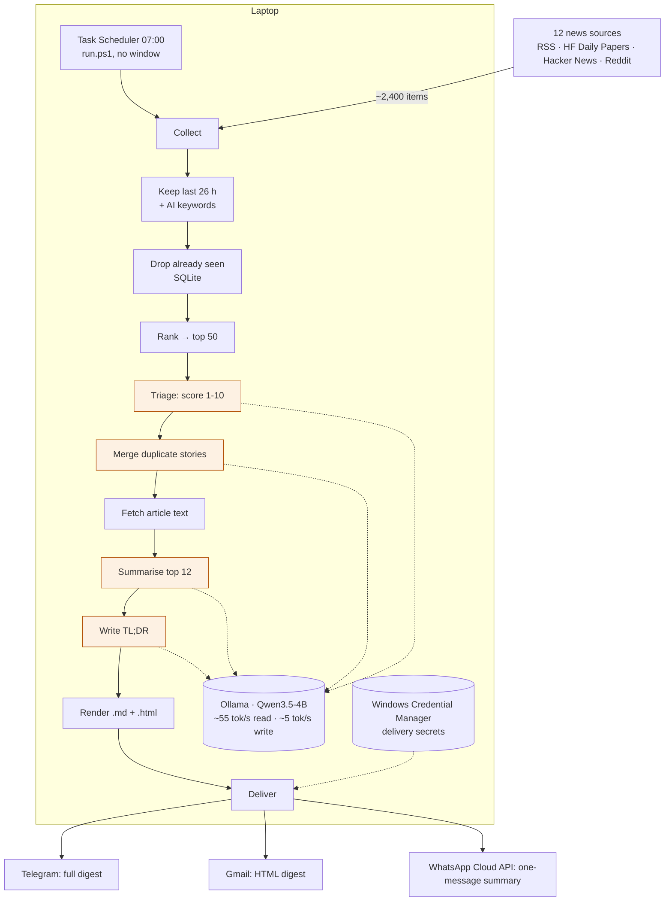

# AI News Agent

A daily digest of the most important AI news, scored and summarised by a **local** LLM
([Qwen3.5-4B](https://huggingface.co/unsloth/Qwen3.5-4B-GGUF) in [Ollama](https://ollama.com)) on an
ordinary Windows laptop: no GPU and no cloud AI. It delivers the digest to Telegram, Gmail and WhatsApp.

Built for a CPU-only laptop (Intel i7-8650U, 16 GB RAM): a full run takes about 24 minutes and costs
about 1–2 US cents of electricity.

## How it works



**Design rules:**
- **Code narrows, the model judges.** Cheap filters cut about 2,400 items down to 50 before the slow CPU model sees any of them.
- **One small job per model call:** score one item, answer one yes/no, or summarise one article. JSON schemas keep outputs parseable, and thinking mode is off.
- **Grounded summaries:** the model only sees the article text, and every story links to its source.
- **Fails soft:** a dead feed, a blocked article or an unconfigured channel is logged and skipped.

A full visual architecture page is in [`docs/architecture.html`](docs/architecture.html). Download it and open it in a browser.

| Measured on the reference laptop | |
|---|---|
| Triage, 50 items | 12.0 min |
| Merge duplicates | 1.8 min |
| Summarise 12 + TL;DR | 9.6 min |
| Collect, filter, fetch, send | 0.2 min |

## Setup (Windows)

1. Install [Python 3.12](https://www.python.org/downloads/) and [Ollama](https://ollama.com/download).
2. Pull the model from Hugging Face:
   ```powershell
   ollama pull hf.co/unsloth/Qwen3.5-4B-GGUF:Q4_K_M
   ```
3. Install the agent:
   ```powershell
   git clone <this repo> ai-news-agent
   cd ai-news-agent
   python -m venv .venv
   .\.venv\Scripts\python.exe -m pip install -r requirements.txt
   ```
4. Check the model speed and try a small run (8 items, nothing saved):
   ```powershell
   .\.venv\Scripts\python.exe bench.py
   .\run.ps1 --test
   ```
   The result is written to `output\YYYY-MM-DD-test.html`.
5. Schedule it daily at 07:00, with no window and allowed to wake the laptop:
   ```powershell
   $root = (Get-Location).Path
   $action = New-ScheduledTaskAction -Execute "conhost.exe" -Argument "--headless powershell.exe -NoProfile -ExecutionPolicy Bypass -File `"$root\run.ps1`"" -WorkingDirectory $root
   $trigger = New-ScheduledTaskTrigger -Daily -At 7:00am
   $settings = New-ScheduledTaskSettingsSet -WakeToRun -StartWhenAvailable -AllowStartIfOnBatteries -DontStopIfGoingOnBatteries -ExecutionTimeLimit (New-TimeSpan -Hours 2)
   Register-ScheduledTask -TaskName "AI News Digest" -Action $action -Trigger $trigger -Settings $settings
   ```
   `conhost --headless` matters on Windows 11: without it, Windows Terminal shows a window, and closing that window kills the run.

## Delivery

Secrets are stored in Windows Credential Manager by `setup_delivery.py`, never in files. Each setup
sends a test message, and channels that aren't set up are skipped.

| Channel | Setup command | Gets |
|---|---|---|
| Telegram | `setup_delivery.py telegram` (token from @BotFather) | Full digest |
| Gmail | `setup_delivery.py email` (needs a Gmail App Password) | Full HTML digest |
| WhatsApp | `setup_delivery.py whatsapp` (see below) | One-message summary |

Run them as `.\.venv\Scripts\python.exe setup_delivery.py <channel>`. To send a real sample: `.\run.ps1 --test --send`.

### WhatsApp (official Meta WhatsApp Cloud API)
A business can only start a WhatsApp conversation with an approved **template**, and a template body
holds at most 1,024 characters on a single line. So WhatsApp gets a compact summary: the date, the TL;DR
and more headlines. The full digest stays on Telegram and Gmail.

1. **App:** https://developers.facebook.com/apps → Create app → use case *Connect with customers through
   WhatsApp*. In the app, go to WhatsApp → **API Setup**.
2. **Recipient:** under "To", add and verify your WhatsApp number. Note the **Phone number ID** below the
   "From" number. This is not the App ID.
3. **Permanent token:** in Business settings → Users → **System users**, add a system user (Admin) →
   *Assign assets* (your app + WhatsApp account) → *Generate token*: expiry **Never**, permissions
   `whatsapp_business_messaging` and `whatsapp_business_management`.
4. **Template:** WhatsApp Manager → Message templates → Create: category **Utility**, name
   `ai_news_digest`, language **English**, body:
   ```
   Your AI news digest for {{1}}:

   {{2}}

   Full digest with links is in your Telegram and email.
   ```
5. Run `setup_delivery.py whatsapp`, which sends Meta's `hello_world` test. After the template is
   approved, run `setup_delivery.py whatsapp-test`.

## Tuning

- `config.yaml`: model, `max_triage` (biggest effect on run time), `top_n`, `min_score`, channels.
- `sources.yaml`: feeds (`rss`, `hf_papers`, `hn`), their weights and keyword filtering.
- `prompts/*.md`: what counts as important, summary style, duplicate rules.
- Better TL;DR: `ollama pull hf.co/unsloth/Qwen3.5-9B-GGUF:Q4_K_M` and set `digest_model`.

## Project layout

| Path | Purpose |
|---|---|
| `agent/main.py` | The pipeline |
| `agent/steps.py` | The four LLM steps: triage, merge duplicates, summarise, TL;DR |
| `agent/llm.py` | Ollama client; logs read and write speed |
| `agent/collect.py`, `prefilter.py`, `store.py`, `extract.py` | Feeds, filtering, SQLite history, article text |
| `agent/render.py`, `deliver.py` | Markdown/HTML output; Telegram, Gmail, WhatsApp |
| `run.ps1` | Scheduler entry point: starts Ollama if needed, logs to `logs/` |
| `setup_delivery.py` | One-time channel setup with test messages |
| `bench.py` | Model speed test |
| `docs/architecture.html` | Visual architecture |
